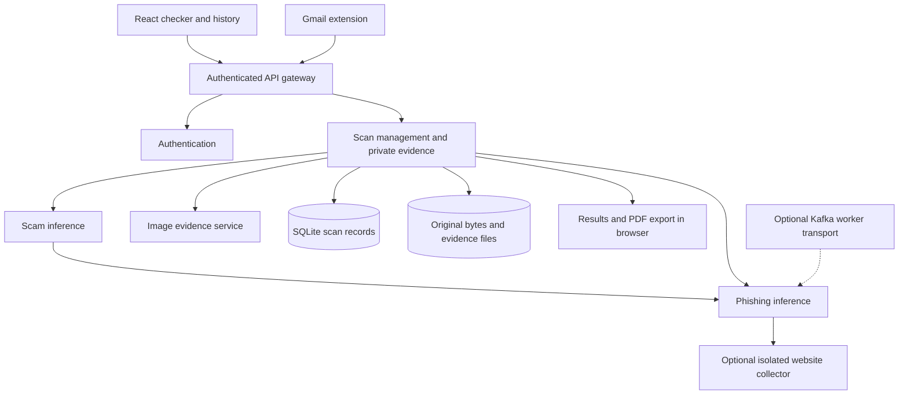

# Runtime architecture

The React website and Chromium Gmail extension send authenticated requests through the FastAPI gateway. Auth issues JWTs. Scan Management owns scan records, original uploads and private evidence files. Owner checks apply to history and evidence retrieval.

Synchronous scans use HTTP. The optional phishing worker uses Kafka and MongoDB. Model HTTP readiness is separate from worker readiness. The supported Windows launcher uses local Python processes plus optional Docker infrastructure. A full containerised production deployment is not established by this diagram.

## Image evidence

The image service loads one pinned CommunityForensics ViT and an experimental frozen-feature head. The latter failed a real high-resolution guard and cannot trigger a standalone AI verdict. A localizer interface currently wraps research-only TruFor. It can be disabled without pretending editing was ruled out. Original bytes remain intact; the classifier's documented tensor view is separate from native or tiled pixel localization.

Evidence includes AI readings, source SHA-256, editable metadata observations, C2PA validation status, image quality and calibrated localization coverage. Missing metadata is neutral. Untrusted credentials never become verified origin. Region alerts require a genuine pixel map, reliability/area filters and the validated image boundary. Native JPEG calibration does not silently extend to lossless or tiled modes.

A separate supporting branch records JPEG-only ELA, noise residuals and ORB/RANSAC repeated-pattern observations in a bounded native window. These diagnostics do not enter verdict fusion. ELA has its own private viewer layer and is explicitly distinguished from the segmentation mask. Failures in this optional branch do not change the decision.

Optional Grad-CAM follows the explanation flag from the image form through Scan Management into the image service. It differentiates the classifier logit and renders attention on the classifier view, not native edit regions. Attention files use the same owner-protected storage as other evidence and can appear in the PDF. The later expanded head was rejected after held-out evaluation; it is not loaded at runtime.

Authenticity verdicts are disabled because generative fill, inpainting, object removal and face swaps are not reliably validated. Other weak or conflicting results are Inconclusive. Conservative abstention reduces assertions; it is not detector accuracy. TruFor and the SafeIMG-derived head impose research/noncommercial restrictions; consult the retained licences before distribution.

## Messages, URLs and reporting

Message inference uses the selected English/Hinglish word/character TF-IDF logistic model. DistilBERT is an optional rollback. Explicit high-risk request rules can raise a warning without inventing classifier probabilities. Hindi standalone classification failed the normal-message release gate; explicit rules can warn while other cases remain uncertain. Model confidence, rule warning index and URL branch results are separate.

Message and email links use the same phishing service as standalone URL scans. Maximum-branch fusion is a warning index, not a calibrated joint probability. Missing link checks remain explicit. Optional live inspection checks public destinations with bounded redirects, body limits, timeouts, TLS verification and SSRF controls, without JavaScript execution. Collection failure is not safety evidence. Optional Groq ordering cannot change predictions.

Scan results and private evidence are persisted before browser rendering. PDF export uses genuine saved evidence and source hashes, with a visible probabilistic-results notice. The extension scans only the selected email after the user action; automated tests do not establish live Gmail compatibility.

Audio, video and fake-review detection are not implemented by the documented current checker. Redis, MinIO/S3, Grafana, ELK and Kubernetes are not runtime dependencies for this local flow. No external research folder or personal Windows path is required. Setup, artifact manifests and verification commands are in the repository README.

## Shared presentation boundary

`DetectionResult.presentation` is computed at serialization so late link fusion cannot leave stale labels. The shared API wrapper also maps historical dictionary records. Reasons carry JSON pointers to their supporting detector record. One bilingual catalogue and token stylesheet feed the website and generated extension assets. Module viewers show actual saved evidence; they do not supply a second verdict. Numerical readings remain inside expert details. PDF exports start with the same public view.

## Questions evaluators may ask

**Why these models?** The selected message lexical model was faster and improved measured warnings on the stated public cohorts. Hindi and MuRIL candidates failed false-alert checks. The image refresh failed its promotion gate, so its weights were not substituted. The URL experts were retained; a policy bug that suppressed scores for popularity, academic domains or unsubscribe paths was removed.

**Why can the answer be uncertain or incomplete?** A model disagreement is uncertainty. A missing or failed required check is incomplete. Neither means safe. Replacing missing evidence with a low score would give false reassurance. A warning from a completed branch can remain in the reasons beside an incomplete headline.

**What is not reliably detected?** Image generative fill, object removal, face swaps, unseen modern generators, broad standalone Hindi classification and new phishing campaigns remain limited. No audio, video or fake-review detector is deployed in this checker. No headline claims universal accuracy.

**How are false positives controlled?** Thresholds are selected on validation, not test. Normal-message checks include OTP/delivery notifications and security advice. Rejected candidates stay out of the default. Real-image FPR intervals refer to the stated AI-stream cohort, not all images or full edit detection. Missing evidence never becomes an authenticity claim.

**Is this independent evaluation?** The manifests record sources, exclusions and hashes. Reused tests are called consumed diagnostics. Unknown upstream overlap, source templates, campaign correlation and noisy public labels remain. The reported numbers are not a prospective field study.

**How is privacy handled?** Local classifiers need no paid provider. Original uploads and scan history are retained on this machine behind owner checks; this is not a claim of automatic deletion or encryption at rest. The Gmail adapter sends only the selected message after a click. Website inspection contacts public destinations and third-party RDAP/reputation sources when requested. Optional Groq is disabled by default and requires explicit configuration/consent. Do not scan sensitive material on an untrusted deployment.

**Can it be used commercially?** TruFor is research/nonprofit restricted. Other dataset and artifact licences also apply. A commercially deployable localizer and rights review are still needed; do not present the current research stack as unrestricted commercial software.
