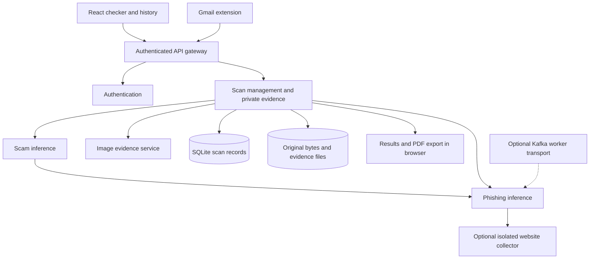

# Runtime architecture

The React website and Chromium Gmail extension send authenticated requests through the FastAPI gateway. Auth issues JWTs. Scan Management owns scan records, original uploads and private evidence files. Owner checks apply to history and evidence retrieval.

Synchronous scans use HTTP. The optional phishing worker uses Kafka and MongoDB. Model HTTP readiness is separate from worker readiness. The supported Windows launcher uses local Python processes plus optional Docker infrastructure. A full containerised production deployment is not established by this diagram.

## Image evidence

The image service loads one pinned CommunityForensics ViT and an experimental frozen-feature head. The latter failed a real high-resolution guard and cannot trigger a standalone AI verdict. A localizer interface currently wraps research-only TruFor. It can be disabled without pretending editing was ruled out. Original bytes remain intact; the classifier's documented tensor view is separate from native or tiled pixel localization.

Evidence includes AI readings, source SHA-256, editable metadata observations, C2PA validation status, image quality and calibrated localization coverage. Missing metadata is neutral. Untrusted credentials never become verified origin. Region alerts require a genuine pixel map, reliability/area filters and the validated image boundary. Native JPEG calibration does not silently extend to lossless or tiled modes.

A separate supporting branch records JPEG-only ELA, noise residuals and ORB/RANSAC repeated-pattern observations in a bounded native window. These diagnostics do not enter verdict fusion. ELA has its own private viewer layer and is explicitly distinguished from the segmentation mask. Failures in this optional branch do not change the decision.

Authenticity verdicts are disabled because generative fill, inpainting, object removal and face swaps are not reliably validated. Other weak or conflicting results are Inconclusive. Conservative abstention reduces assertions; it is not detector accuracy. TruFor and the SafeIMG-derived head impose research/noncommercial restrictions; consult the retained licences before distribution.

## Messages, URLs and reporting

Message inference retains the selected English DistilBERT/TF-IDF mixture. Explicit high-risk request rules can raise a warning without inventing classifier probabilities. Hindi/Hinglish outside validated model coverage receives a warning or an explicit inability to assess. Model confidence, rule warning index and URL branch results are separate.

Message and email links use the same phishing service as standalone URL scans. Maximum-branch fusion is a warning index, not a calibrated joint probability. Missing link checks remain explicit. Optional live inspection checks public destinations with bounded redirects, body limits, timeouts, TLS verification and SSRF controls, without JavaScript execution. Collection failure is not safety evidence. Optional Groq ordering cannot change predictions.

Scan results and private evidence are persisted before browser rendering. PDF export uses genuine saved evidence and source hashes, with a visible probabilistic-results notice. The extension scans only the selected email after the user action; automated tests do not establish live Gmail compatibility.

Audio, video and fake-review detection are not implemented by the documented current checker. Redis, MinIO/S3, Grafana, ELK and Kubernetes are not runtime dependencies for this local flow. No external research folder or personal Windows path is required. Setup, artifact manifests and verification commands are in the repository README.
